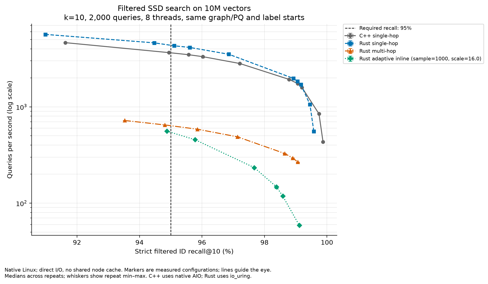

# Rust single-hop filtered SSD search: experiment report

Date: 2026-10-21. **Authoritative comparisons are complete:** eight-thread top-10 at 95%/99% recall floors, one-thread top-10, and top-100/top-1,000 fixed profiles, with 135 validated repeats across 45 configurations. The final top-1,000 inline diagnostic is complete; it returns short results on nine queries and is excluded from performance claims.

The prototype imports the existing C++ topology and adds strict filtered traversal in Rust. At top-1,000, the same `L=4,000` and approximately 98.8% recall yield **7.78× multi-hop and 1.36× C++ throughput**, yet Rust p99 remains approximately **103 ms**. At top-10, the fastest global-floor gains retain per-label regressions; the conservative measured 95%-floor option is slower than the selected C++ baseline. Production migration still needs a supported filter-aware build/ingestion path and validation against the service's own quality and latency requirements.

## What this prototype establishes

The Rust prototype adds strict single-hop filtered traversal and explicit starting points to the disk search path. It can import a supported legacy C++ disk graph, its PQ codes and its label entry points, then compare three Rust search modes on the same artifacts:

| Search mode | Navigation behavior |
| --- | --- |
| Strict single-hop | Compute search distances and navigate only through nodes satisfying the predicate. Start at the corresponding label entry point. |
| Multi-hop | Expand through rejected neighbors to find eligible candidates. |
| Adaptive inline | Navigate the graph while collecting eligible results; adapt the search-list size according to observed matches. |

The principal comparison uses the same label entry points for all three modes. Strict single-hop requires eligible starting points. Global-start inline or multi-hop runs are optional topology diagnostics: a stitched union of label-specific graphs need not support navigation from one global entry point to every label. A failed global-start search on that graph would not represent the performance of a conventional unfiltered Rust index. Adaptive sample and scaling parameters are tuning configurations, alongside the search-list size `L`.

This prototype **does not implement a Rust filter-aware index builder**. The C++ graph is imported unchanged; the legacy metadata header is translated in memory. The importer supports uint8/L2 indexes without dummy replicas or reorder data, with nodes that fit within one disk sector; it cannot load every legacy production index. Existing default search behavior remains available. A successful same-graph traversal comparison would establish a query-path improvement on that topology, not parity with a complete Rust ingestion/build/update implementation.

Implementation and execution details are in the [experiment README](../../tools/single-hop-benchmark/README.md) and [C++ reference README](../../tools/single-hop-benchmark/cpp-port/README.md).

## Dataset and predicates

The source is the public [BigANN 2023 YFCC10M filtered-search dataset](https://big-ann-benchmarks.com/neurips23.html), released under CC BY 4.0: 10 million 192-dimensional uint8 CLIP vectors with L2 distance, natural image metadata and 100,000 public queries. Metadata includes description terms, camera model, year and country. Its vocabulary contains 200,386 tags. The public query file contains 61,626 one-tag predicates and 38,374 two-tag conjunctions.

Only original one-tag predicates are used here. No conjunction is changed to an OR predicate. The conjunction query IDs are retained as an explicit holdout. **Sixty-four queried natural labels are selected from the 200,386 original metadata columns**, deterministically across match-rate regimes, requiring at least ten available one-tag queries per selected label. Query sampling balances labels where available and then applies a seeded shuffle. This balanced label sample stresses different selectivities; it is not the original query-frequency distribution or a production advertising query mix.

| Prepared dataset | Base vectors | Queries | Exact truth width | Smallest / largest eligible set |
| --- | ---: | ---: | ---: | --- |
| 1M pilot | 1,000,000 | 1,000 | 10 | 364 / 192,699; 0.0364% / 19.2699% |
| Full 10M | 10,000,000 | 2,000 | 10 | 5,936 / 1,915,985; 0.05936% / 19.15985% |
| Full 10M large-k subsets | 10,000,000 | 256 each | 100 and 1,000 | Same 64 label sets as full 10M |

The recorded sampling seed is `20261021`. Round-robin selection yields 10–17 queries per label in the 1M pilot and 10–43 per label in the full top-10 set because some labels exhaust their available original one-tag queries. The large-k sets use exactly four per label. Query order is deterministically shuffled. The source vector values are uint8 and therefore finite; conversion for exact-distance computation introduces no NaN or infinity values.

The 1M pilot is a deterministic prefix of the downloaded 10M base. Its filtered ground truth is recomputed exhaustively. Removing out-of-prefix IDs from the published top-10 would not produce correct prefix ground truth. The full 10M top-10 truth copies the corresponding original published query rows.

All original base vectors remain present. Graph construction retains only the 64 selected natural labels and drops all other original tags. Each vector keeps every selected label that applies; a row retaining none receives the unrelated sentinel label `200386`. The sentinel is never queried and has no universal-label semantics. Selected natural predicates retain exactly their original membership. Consequently, this graph does not establish the cost or quality of constructing an index with all 200,386 original tags. The Rust harness also uses one dense 10M-bit membership bitmap per selected label, approximately 76.3 MiB for 64 labels; that is not a production representation plan for 200,000 labels. The core accepts arbitrary predicates, so scalable ingestion must choose an appropriate categorical/posting/bitmap representation and measure its membership cost. Per-label counts and original IDs are recorded in the dataset manifests:

- [1M dataset manifest](results/dataset-1m-manifest.json)
- [10M dataset manifest](results/dataset-10m-manifest.json)
- [Preparation verification](results/dataset-preparation-verification.json)

The standalone prepared-data verifier passed on the native Linux copies of all three full-10M prepared sets: top-10, top-100 and top-1,000. It checks manifest sizes and SHA-256 hashes, base/query dimensions, every selected-label posting and its agreement with the C++ label rows, and every recorded ground-truth ID's eligibility, uniqueness and distance ordering. This is a transfer/integrity check; it does not repeat the exhaustive nearest-neighbor calculation. See [native prepared-data verification](results/prepared-integrity-native.json).

## The index topology mattered before search speed

The first combined FilteredVamana pilot (`R=64`, `Lbuild=100`, filtered build-list size 100, plain PQ32, no dummy replicas) failed the quality contract. Labels 345, 832, 2027 and 3901 had entry points with degree 64 but **zero eligible outgoing neighbors**. Increasing the search-list size cannot leave such an entry point under strict one-hop navigation. This demonstrates a connectivity failure for this configuration, not a claim about all FilteredVamana configurations. The initial C++ CLI also exposed an upstream short-output bounds issue; its invalid outputs/timings are excluded. The adapter now bounds output by the actual result count and reports short results.

The usable pilot baseline uses the official C++ StitchedVamana builder: per-label `R=32`, final `R=128`, `Lbuild=100`, alpha 1.2, and the same PQ32 representation. It first builds label-specific graphs and then stitches/prunes them. All 64 pilot entry points have eligible outgoing neighbors; the inspected range is 4–40 matching neighbors. See the retained [entry-point connectivity diagnostic](results/stitched-1m-entry-connectivity.json).

An independently validated C++ pilot quality check reached 96.56% strict ID recall@10 at `L=40` and 99.75% at `L=160` over 1,000 queries, with zero short queries, filter violations or duplicate IDs. These are **quality diagnostics only**; their latency and QPS are excluded because writes and other work were active.

Changing the builder also changes degree, index size and construction work. Comparing the failed `R=64` graph with the stitched `R=128` graph is not a controlled estimate of a builder speedup. The final traversal ablation must use one identical stitched graph/PQ artifact set across Rust modes. Any separate builder comparison must report topology, degree, index size and build cost alongside query results.

The full 10M official stitched graph is now built on the Mac using the same per-label `R=32`, final `R=128`, `Lbuild=100`, alpha 1.2 and eight build threads. The PQ32 pivots were trained on the earlier 1M pilot, then frozen and reused to encode all 10M vectors. Thus the recorded 10M PQ encoding duration excludes PQ training. The same graph, PQ codes, pivots, label map and label entry points are transferred to Linux and shared across implementations. Every transferred artifact matches its recorded size and SHA-256 hash; see the [shared index manifest](results/shared-index-manifest.json) and [native index verification](results/shared-index-native-verification.json).

An initial full-set native Rust strict single-hop check reached recall@10 of 96.86%, 98.93%, 99.46% and 99.58% at `L=80/160/320/640`, respectively, over all 2,000 top-10 queries with eight threads. Each configuration had zero short queries, filter violations or duplicate IDs. These records have `timing_authoritative: false` and establish quality only; their QPS and latency are excluded from performance results. See [full-set strict quality diagnostics](results/rust-10m-single-full-quality.jsonl).

## Pinning and platform limitations

The C++ reference is pinned to upstream `cpp_main` commit `78256bbab4685e1774e78d331e081a153be26823`. The complete portability patch, dependency checksums, binary checksums and compiler settings are retained in [macos-build-evidence.json](../../tools/single-hop-benchmark/cpp-port/macos-build-evidence.json). The Rust checkout base for this work is `79c5fcf77b6b26c403c3803aa04839e633d15642`; final run provenance must identify the actual source state, compiler/toolchain and optimized binary used, including local changes.

The local reference runs on Apple arm64. Its C++ adapter uses the existing scalar/auto-vectorized distance paths, Apple Accelerate CBLAS in place of MKL, and blocking positional reads with `F_NOCACHE`. Requests within a beam execute sequentially. It also repairs platform type/header assumptions, an inclusive stitched-builder random upper bound, and the short-output bounds issue. Plain PQ is used; OPQ is unsupported. These changes are disclosed rather than treated as an unmodified production C++ build.

The Rust local benchmark uses aligned positional reads with `F_NOCACHE`, not the default macOS reader that loads the graph into memory. Rust SIMD behavior, the C++ scalar path, allocation, scheduling and instrumentation still differ. Therefore a Rust-versus-C++ ratio on this machine describes these local implementations and adapters. It does not measure language efficiency or native x86/Linux performance parity. The same-artifact comparison among Rust search modes isolates traversal behavior more directly.

C++ graph construction uses randomness and parallel updates without a single public reproducibility seed. Preserve graph, PQ, label-map and entry-point artifact hashes and reuse those exact files for ablations. Query/data selection is separately reproducible from recorded seeds and checksums.

## Timing, recall and selection contract

Final timing runs must execute without concurrent builds or other deliberate CPU/SSD work. Each configuration receives a full query-set warmup at the same concurrency as measurement, including initialization of the Rust scratch/reader pool. Run at least three measured repeats for each reported configuration. Diagnostic records have `timing_authoritative: false`; final uncontended local measurements explicitly opt in with `true`. That flag is provenance about this local run, not certification of a production SLO.

Both implementations report monotonic latency around the complete public search call, with `latency_contract: public_search_call`. This includes query/PQ preprocessing and search-call allocation/scratch work. Index loading, warmup, output serialization and independent correctness validation stay outside the timed query loop. Label conversion and predicate/entry-point setup precede the public-call latency timer; QPS uses the complete query-loop wall time, including driver scheduling and per-query setup. The final Rust harness uses dynamic scheduling of one query at a time to match the C++ driver's scheduling policy; their worker frameworks and scratch/allocation implementations still differ.

Result validation uses strict ID recall against the exact eligible-set ground truth, and `k` must equal the supplied truth width. A result must contain `k` unique eligible IDs. Short queries, filter violations and duplicates are reported explicitly; missing validation is unknown rather than assumed successful. Strict ID evaluation can penalize alternative IDs tied at the cutoff, consistently across implementations; no unrecorded tie expansion is applied.

At a chosen global recall floor, such as 95%, the summarizer selects the fastest median-QPS **measured** configuration. Every repeat must satisfy the recall floor, public-call timing contract, authoritative-timing flag and explicit result-validity requirements. No interpolation is used. Configuration identity includes the index prefix, prepared query/label/truth fingerprints, query count, `k`, thread count, beam, start policy, storage/cache settings and latency contract. Adaptive tuning values remain separate when grouping repeats; selection can choose among their qualifying configurations. Report repeat ranges as well as medians.

Per-label recall stays visible. The optional regression diagnostic compares selected modes with a compatible selected multi-hop run at the same required global floor. A label recall drop strictly greater than one percentage point is flagged. Incompatible query sets, `k`, eligible-set counts or execution settings are skipped explicitly. These warnings do not change aggregate eligibility and are not significance tests; small per-label query counts limit confidence.

Reader request counts and requested bytes are logical file requests, not physical-device IOPS. PQ codes and predicate membership stay in RAM; no shared graph-node cache is used in the principal comparison. `F_NOCACHE`/direct I/O and full warmup do not guarantee cold device caches. Rust `mean_cmps` counts search/PQ comparisons, excluding full-precision reranking; C++ PQ and full-distance counters must remain separate.

## Large candidate volumes

`prepare_large_k.py` selects exactly four existing one-tag queries per natural label, shuffles them deterministically, and computes exact top-1,000 neighbors against the full eligible subsets of all 10M base vectors. Float64 chunked exhaustive computation makes the uint8 squared-L2 arithmetic exact; original IDs break ties. Top-100 truth is the prefix of those same top-1,000 results. All returned memberships and distances are checked, with independent integer exhaustive checks for the two smallest and two largest eligible sets.

The base vectors, label rows and postings are shared through symlinks. Original predicates and query vectors are verified unchanged. These datasets provide a candidate-volume correctness/scaling check beyond the published top-10 benchmark; 256 queries provide only coarse tail estimates. Top-100 and top-1,000 use identical queries and order. The existing 2,000-query top-10 set has a different sample, so cross-set QPS differences cannot be attributed solely to `k`.

- [Top-100 manifest](results/dataset-10m-k100-manifest.json)
- [Top-1,000 manifest](results/dataset-10m-k1000-manifest.json)

The native candidate-volume profiles use the same graph/PQ and 256-query order, three authoritative repeats per configuration, full warmup, beam four, eight threads, direct I/O and no shared graph-node cache. All 21 repeats across seven configurations have zero short results, filter violations or duplicates. Filtered modes use fixed `L=4k`; top-100 inline uses `L=6,400`, sample size 1,000 and scale 16. These profiles satisfy the 95% global floor; they are not exhaustive tuning sweeps or 99% comparisons.

| k | Native method | L | Actual recall | QPS median [range] | p99 ms median [range] | Logical reads/query |
| ---: | --- | ---: | ---: | ---: | ---: | ---: |
| 100 | C++ single-hop | 400 | 97.031% | 673 [672–674] | 13.109 [12.853–13.213] | 412.1 |
| 100 | Rust strict single-hop | 400 | 97.012% | 847 [820–869] | 11.712 [9.754–17.266] | 413.2 |
| 100 | Rust multi-hop | 400 | 96.957% | 111 [110–111] | 83.092 [80.489–83.445] | 8,677.2 |
| 100 | Rust adaptive inline | 6,400 | 96.316% | 21.98 [21.86–22.24] | 564.421 [554.119–568.435] | 16,748.0 |
| 1,000 | C++ single-hop | 4,000 | 98.801% | 66.16 [65.99–66.20] | 147.648 [146.673–149.079] | 4,007.4 |
| 1,000 | Rust strict single-hop | 4,000 | 98.799% | 90.03 [90.01–90.50] | 102.635 [102.513–102.866] | 4,008.4 |
| 1,000 | Rust multi-hop | 4,000 | 98.793% | 11.57 [11.53–11.64] | 735.238 [726.463–737.285] | 82,210.8 |

At top-100, strict single-hop provides 7.65× multi-hop, 38.53× inline and 1.26× C++ median QPS. At top-1,000, it provides **7.78× multi-hop and 1.36× C++ QPS**, with nearly identical recall at the same `L=4,000`; logical reads fall 20.51× versus multi-hop. These fixed-profile comparisons are especially useful because their result counts and filtered-mode search-list sizes match. Top-100 strict p99 varies from 9.754 to 17.266 ms across repeats, so its lower median does not imply a uniform tail-latency improvement in every repeat.

With only four queries per label, the observed top-100 minimum label recalls are C++ **88.50%**, strict **88.50%**, multi-hop **88.00%** and inline **62.75%**. Top-1,000 minima are C++/strict **93.625%** and multi-hop **93.75%**. Strict has no observed label loss greater than one percentage point against either reference at either `k`: maximum losses are 0.25/0.75 points against C++/multi-hop at top-100 and 0.025/0.125 points at top-1,000. Inline at top-100 has twenty flagged labels against multi-hop, with a maximum 37.25-point loss. These are sample diagnostics, not quality guarantees or significance tests. See the [top-100 summary](results/native-summary-k100-95.json), [top-1,000 summary](results/native-summary-k1000-95.json), and [supplementary label analysis](results/native-supplementary-label-analysis.json).

[Top-100 QPS/p99/read comparison](results/native-10m-k100-t8-95-matched-floor.png) ([SVG](results/native-10m-k100-t8-95-matched-floor.svg)) · [Top-1,000 comparison](results/native-10m-k1000-t8-95-matched-floor.png) ([SVG](results/native-10m-k1000-t8-95-matched-floor.svg)).

At top-1,000, even the C++ baseline has approximately **148 ms p99**, and Rust strict still has approximately **103 ms p99**, on this SSD configuration. A large relative filtering gain therefore does not establish a low-single-digit-millisecond ads candidate-stage budget. Candidate count, I/O strategy and the actual serving trace remain material. The final native top-1,000 inline diagnostic uses all 256 queries, `L=64,000`, sample size 1,000 and scale 16. It reaches **95.715625% recall but returns fewer than 1,000 results on nine queries**, with zero filter violations or duplicate IDs. It is one diagnostic row with `timing_authoritative: false`; it fails the complete-result requirement and is excluded from performance summaries, figures and ratios. **No qualified top-1,000 inline comparison is reported.** See the [final diagnostic](results/rust-k1000-inline-quality.jsonl), [run record](results/rust-k1000-inline-quality.run.txt), and [resource record](results/rust-k1000-inline-quality.resources.txt).

The Rust mixed single-/multi-hop process peaks were 505,888 KiB (494.0 MiB) at top-100 and 581,864 KiB (568.2 MiB) at top-1,000; top-100 inline peaked at 980,660 KiB (957.7 MiB). All reported zero swaps. These are whole-job peaks including both modes where applicable, not isolated configuration/scratch measurements. See the [top-100 filtered resource record](results/rust-k100-filtered.resources.txt), [top-1,000 filtered record](results/rust-k1000-filtered.resources.txt), and [top-100 inline record](results/rust-k100-inline.resources.txt). The independently checked [C++ candidate evidence](../../tools/single-hop-benchmark/cpp-port/native-candidate-summary.json) records its driver/child-process resource scope separately.

Supplementary Mac quality checks used only 64 of these 256 queries, at eight threads. They are diagnostic samples with `timing_authoritative: false`, not final performance measurements. Adaptive inline used sample size 1,000 and scale 16. The following observations retain the full-`k` result contract:

| k | Rust mode | L | Strict ID recall | Short queries / 64 |
| ---: | --- | ---: | ---: | ---: |
| 100 | Single-hop / multi-hop | 400 | 97.50% / 97.48% | 0 / 0 |
| 100 | Adaptive inline | 6,400 | 96.39% | 0 |
| 1,000 | Single-hop / multi-hop | 4,000 | 98.94% / 98.94% | 0 / 0 |
| 1,000 | Single-hop / multi-hop | 8,000 | 99.57% / 99.58% | 0 / 0 |
| 1,000 | Adaptive inline | 32,000 | 93.08% | 3 |
| 1,000 | Adaptive inline | 64,000 | 96.34% | 1 |

Lower top-100 inline settings (`L=100/200`) also produced short results. In particular, top-1,000 inline at `L=64,000` exceeds 95% aggregate recall but **fails the required complete-result contract**. It is therefore ineligible for a matched-quality speedup comparison. No qualified top-1,000 inline speedup can be reported unless a complete, valid configuration is measured on the full 256-query native set; further capped inline checks may remain supplementary diagnostics. See [top-100 checks](results/rust-k100-quality-mac.jsonl), [top-100 higher-L inline](results/rust-k100-inline-high-quality-mac.jsonl), [top-1,000 checks](results/rust-k1000-quality-mac.jsonl), [top-1,000 higher-L inline](results/rust-k1000-inline-high-quality-mac.jsonl), and [top-1,000 L64,000 inline](results/rust-k1000-inline-64000-quality-mac.jsonl). These quality findings do not relax the main top-10 comparison requirements.

## Native eight-thread top-10 results

The following completed rows use the same 10M stitched graph/PQ, all 2,000 top-10 queries, eight threads pinned to CPUs 0–7, beam four, label entry points, direct I/O and no shared graph-node cache. Each configuration has three authoritative repeats with zero short results, filter violations or duplicate IDs. Selection is maximum measured median QPS subject to the stated **global** recall floor in every repeat; this does not enforce the floor separately for each label. Bracketed values are repeat min–max ranges, not confidence intervals. Both floors have all four methods. Inline uses sample size 1,000 and scale 16; selection searches the measured `L` grid rather than claiming exhaustive algorithm/hyperparameter optimization.

| Required recall | Method | Selected L | Actual recall | QPS median [range] | p99 ms median [range] | Logical reads/query |
| --- | --- | ---: | ---: | ---: | ---: | ---: |
| 95% | C++ single-hop | 60 | 95.570% | 3,476 [3,471–3,482] | 3.388 [2.841–3.417] | 77.1 |
| 95% | Rust strict single-hop | 60 | 95.110% | 4,302 [4,226–4,395] | 2.640 [2.314–3.143] | 78.1 |
| 95% | Rust multi-hop | 64 | 95.855% | 585 [584–586] | 15.926 [15.810–16.017] | 1,638.2 |
| 95% | Rust adaptive inline | 320 | 95.780% | 456 [454–456] | 26.428 [26.426–26.594] | 935.3 |
| 99% | C++ single-hop | 144 | 99.065% | 1,743 [1,720–1,744] | 5.317 [5.279–5.867] | 159.3 |
| 99% | Rust strict single-hop | 176 | 99.055% | 1,841 [1,810–1,842] | 4.943 [4.888–5.607] | 191.9 |
| 99% | Rust multi-hop | 160 | 99.065% | 268 [265–268] | 33.105 [32.937–33.507] | 3,611.1 |
| 99% | Rust adaptive inline | 2,560 | 99.115% | 58.8 [58.2–59.1] | 208.878 [208.848–209.973] | 6,978.4 |

Minimum per-label recalls at the selected 95% settings are C++ **87.67%**, Rust strict **86.28%**, multi-hop **88.84%** and adaptive inline **72.00%**. At the selected 99% settings they are C++ **94.88%**, strict **96.05%**, multi-hop **96.19%** and inline **91.00%**. These minima are over small label samples, not separate recall guarantees.

The global-floor selections give strict single-hop 7.35× / 6.87× the multi-hop QPS at the 95% / 99% floors and 1.24× / 1.06× the C++ QPS. Strict provides 9.45× / 31.33× adaptive inline QPS at those two floors. These describe this graph, predicate sample, machine and implementations; they do not establish equal quality for every label. The [95% summary](results/native-summary-95.json) and [99% summary](results/native-summary-99.json) record all four methods, source hashes and complete configuration summaries, with links to plot provenance. The [cross-reference label analysis](results/native-t8-label-analysis.json) records exact comparisons against the selected C++ and multi-hop references.

[Recall/QPS SVG](results/native-10m-t8-95-recall-qps.svg) · [95% QPS, p99 and logical-read comparison](results/native-10m-t8-95-matched-floor.png) ([SVG](results/native-10m-t8-95-matched-floor.svg)) · [99% comparison](results/native-10m-t8-99-matched-floor.png) ([SVG](results/native-10m-t8-99-matched-floor.svg)). Points and repeat ranges are measurements; connecting lines guide the eye.

The C++ comparison includes a difference in work ordering. In the [pinned upstream query loop](https://github.com/microsoft/DiskANN/blob/78256bbab4685e1774e78d331e081a153be26823/src/pq_flash_index.cpp#L1570-L1593), PQ distances are computed for every adjacency ID before visited and label checks. The Rust strict path deduplicates and filters before computing accepted-neighbor distances; its regression test checks that rejected distances are never computed. At `L=60`, the native C++ run averages 6,599.8 PQ comparisons and 5,106.7 label checks per query, versus 1,492.0 PQ comparisons for Rust strict. Logical reads are similar, 77.1 versus 78.1, and C++ reader time averages about 1.59 ms within a 2.30 ms public call. Rust uses prebuilt membership bitmaps while C++ retains its native label lookup, another implementation difference. Thus the cross-language comparison measures traversal/work ordering, predicate representation and other implementation choices, not language efficiency; reducing PQ work does not remove the I/O cost. All three Rust modes use the same membership representation.

**Per-label quality changes the recommendation.** At the 95% global floor, strict `L=60` has observed recall losses greater than one percentage point on 6 labels against selected C++ `L=60` and 14 against selected multi-hop `L=64`. Its minimum label recall is 86.28%. `L=80` still loses 2.33 percentage points on label 8 against multi-hop. The fastest measured strict configuration with no observed loss above that threshold against **both** selected references is `L=160`: 98.925% global recall, 1,974 QPS, p99 5.297 ms, and minimum label recall 95.12% (label 8). That extra quality margin reduces QPS to 46% of strict `L=60`; it remains 3.37× multi-hop and 4.33× inline QPS but is 43% below the selected C++ 95%-floor QPS. This is a conservative sample-based option, not a proven per-label guarantee.

At the 99% floor, **no measured strict configuration meets the no-observed-loss-above-one-percentage-point diagnostic against both references**. `L=176` has two flagged labels versus multi-hop (`8`: 2.33 points; `36`: 1.19); `L=192` and `L=320` each retain a 1.63-point loss on label 8. `L=640` passes this comparison against multi-hop but loses 1.11 points on label 3677 against C++. Minimum label recall is 96.05% at strict `L=176`, 96.74% at `L=320` and 98.44% at `L=640`. Larger `L` does not make approximate per-label recall monotonic. At the 95% floor, selected inline `L=320` also has 34 labels more than one percentage point below selected multi-hop; its largest observed loss is 26 points on label 1227 (72% versus 98%). At the 99% floor, inline `L=2,560` has ten such flags, with a maximum eight-point loss on label 1227. The 10–43 queries per label support diagnostic flags, not significance or generalization claims; a production trace must set its own acceptance gate.

## One-thread top-10 comparison

This supplementary profile uses the same 2,000 top-10 queries and graph/PQ, with one worker and CPU affinity restricted to 0–7. C++ measures `L=64/80`; Rust strict/multi-hop use fixed `L=64`, and inline uses `L=320` with sample 1,000 and scale 16. All fifteen repeats across five configurations have zero short results, duplicates or filter violations and use the public-call timing contract. The 95%-floor selection chooses C++ `L=64`; this is a limited profile, not a separate exhaustive one-thread tuning sweep.

| Method | L | Actual recall | QPS median [range] | p99 ms median [range] | Logical reads/query | Minimum label recall |
| --- | ---: | ---: | ---: | ---: | ---: | ---: |
| C++ single-hop | 64 | 96.025% | 407.07 [406.73–407.15] | 3.043 [3.039–3.053] | 81.0 | 88.14% |
| Rust strict single-hop | 64 | 95.610% | 535.16 [534.01–535.45] | 2.418 [2.405–2.421] | 82.0 | 87.67% |
| Rust multi-hop | 64 | 95.855% | 123.58 [123.51–123.61] | 9.344 [9.282–9.498] | 1,638.2 | 88.84% |
| Rust adaptive inline | 320 | 95.780% | 64.99 [64.98–64.99] | 23.545 [23.529–23.714] | 935.3 | 72.00% |

Strict provides 4.33× multi-hop, 8.23× inline and 1.31× C++ median QPS in this profile. Its selected `L=64` has four label drops above one percentage point versus C++ and eight versus multi-hop, with maximum losses of 1.82 and 3.26 points respectively; inline has 34 flags versus multi-hop. This does not establish the per-label acceptance gate. Thread-scaling comparisons must hold `L` fixed rather than divide independently selected `L=60` eight-thread and `L=64` one-thread throughputs. See the [one-thread summary](results/native-summary-t1-95.json), [label diagnostics](results/native-supplementary-label-analysis.json), and [QPS/p99/read comparison](results/native-10m-t1-95-matched-floor.png) ([SVG](results/native-10m-t1-95-matched-floor.svg)).

## Build and resident-memory measurements

| Build artifact | Parameters | Recorded Mac duration | Peak RAM | Serialized size | Artifact hashes |
| --- | --- | --- | --- | --- | --- |
| 10M stitched graph construction | Per-label R32, final R128, L100, alpha 1.2, 8 threads | 638.6439 s | Not recorded | Final disk graph: 8,192,004,096 bytes | [Shared manifest](results/shared-index-manifest.json) |
| 10M PQ encoding | 32 bytes/vector, frozen 1M-trained pivots, 8 threads | 104.3390 s; excludes training | Not recorded | Codes: 320,000,008 bytes; pivots: 201,628 bytes | [Shared manifest](results/shared-index-manifest.json) |
| Disk layout serialization | Same stitched graph and full uint8 vectors | 6.4222 s | Not recorded | Label rows: 59,940,263 bytes; map: 439 bytes; entry points: 768 bytes | [Shared manifest](results/shared-index-manifest.json) |

These are observed Mac construction-stage durations, not native Linux build measurements or uncontended query timings. Peak resident memory was not measured. Memory compression and swap were observed during construction, so a build-memory budget flag must not be substituted for a measured peak or used to infer a no-swap memory requirement.

Native Rust query jobs recorded the following whole-process maximum resident sets, each with eight threads and three repeats per `L`. They include initialization, index/PQ/predicate state and scratch across the entire job; they do not isolate the selected configuration or measure construction peak RAM. All five resource records report zero swaps.

| Native Rust job | Complete L grid | Peak RSS | Resource record |
| --- | --- | ---: | --- |
| Strict single-hop | 40, 80, 160, 320, 640 | 490,700 KiB / 479.2 MiB | [Record](results/rust-main-t8-single.resources.txt) |
| Strict refinement | 56, 60, 64, 176, 192 | 489,720 KiB / 478.2 MiB | [Record](results/rust-main-t8-single-refine.resources.txt) |
| Multi-hop | 48, 56, 64, 80, 128, 144, 160 | 497,944 KiB / 486.3 MiB | [Record](results/rust-main-t8-multihop.resources.txt) |
| Adaptive inline | 256, 320, 640, 1,024, 1,280 | 641,524 KiB / 626.5 MiB | [Record](results/rust-main-t8-inline.resources.txt) |
| Adaptive inline high-L | 2,560 | 697,544 KiB / 681.2 MiB | [Record](results/rust-main-t8-inline-high.resources.txt) |

The final interpretation should distinguish query throughput, per-call latency, resource cost and quality. Faster low-recall or short-result configurations are excluded. A local traversal gain does not directly predict ad-service end-to-end latency, capacity, revenue or recall of downstream ranking candidates.

## Native Linux and migration decision

The native host has an AMD Ryzen 9 7950X, 16 cores / 32 threads, approximately 61 GiB RAM, and a WD_BLACK SN850X 2000GB NVMe drive on ext4. It runs Ubuntu 24.04.1, kernel 7.0.0-34-generic x86_64, with the performance CPU governor and the `none` I/O scheduler. The eight-thread affinity plan uses CPUs 0–7, one hardware thread on each of eight physical cores. This is a desktop with background services, so an uncontended benchmark flag does not imply an isolated production host. See [native host provenance](results/native-host.json).

Native Rust core single-hop, seed selection/replacement, filtering, and all six aligned Linux-reader tests pass, and smoke checks exercise actual `io_uring` reads. The optimized native build uses Rust 1.97.1 and the `x86-64-v3` target. [Native Rust build evidence](results/native-rust-build.json) retains the core test results and the earlier harness/binary hashes. Only the benchmark driver subsequently changed to dynamic query scheduling; [final harness provenance](results/native-rust-final-harness.json) records the final driver and binary hashes and passing smoke validation. The native C++ reference now runs successfully with original x86 SIMD, MKL and Linux AIO paths retained. An initial OpenMP/Archer startup crash disappeared on the unchanged binary after setting `OMP_TOOL=disabled`, which disables optional OpenMP tooling. The symptoms are consistent with the Archer/tcmalloc symbol-detection problem in [LLVM issue 122319](https://github.com/llvm/llvm-project/issues/122319); this is an environment workaround, not a proven diagnosis or an algorithm change. [Native C++ build evidence](../../tools/single-hop-benchmark/cpp-port/native-linux-build-evidence.json) records source/patch/binary/package hashes, compiler settings, affinity and runtime environment. Final C++ query outputs are independently checked against the same strict ID truth and predicates.

Final evidence is retained in the [local check results](results/final-checks.json), [frozen native inventory](results/final-native-inventory.json), and [independent Rust source/evidence review](results/rust-final-review.json). The inventory covers 17 authoritative JSONLs, 135 repeats and 45 configurations with matching experiment contracts and zero recorded result errors. Presentation/source-input/figure hashes and summary consistency are checked separately in the [analysis verification](results/native-final-analysis-verification.json). The [final native host check](results/final-native-host-check.txt) confirms the recorded binary is unchanged and no benchmark search process remains. Affected-crate Clippy and formatting checks pass; whole-workspace tests/Clippy and coverage CI were not run.

**The required authoritative performance comparisons are complete:** the eight-thread top-10 sweeps, the primary 95%-floor one-thread profile, and the separate top-100/top-1,000 profiles on their shared 256-query subset. Large-`k` inline settings without complete valid results remain diagnostic and receive no matched-quality speedup claim. All comparisons must retain the same CPU, SSD, filesystem, memory/cache budget, graph/PQ artifacts and query contracts, preserving compiler settings and artifact hashes.

For an ads-like service, the subsequent gate is a representative trace containing the actual embedding dimension, candidate count, filter selectivity/correlation, compound predicates, updates and skew. Measure open-loop offered load and request p95/p99 under shard fanout and merging, including queueing and network time. This experiment measures per-process closed-loop search; it does not establish those distributed service SLOs. Stable categorical labels can inform graph topology, while rapidly changing eligibility and predicate intersections may require additional query strategies and update handling.

The topology failure already supports one design conclusion: adding a predicate gate only to the search loop cannot make an unsuitable graph navigable. The measured gains above are conditional on this topology, predicate representation, query sample and quality contract. A production Rust migration still needs a supported filter-aware builder/ingestion path, label/entry-point persistence, update semantics and validation against the application's candidate and latency contracts.
