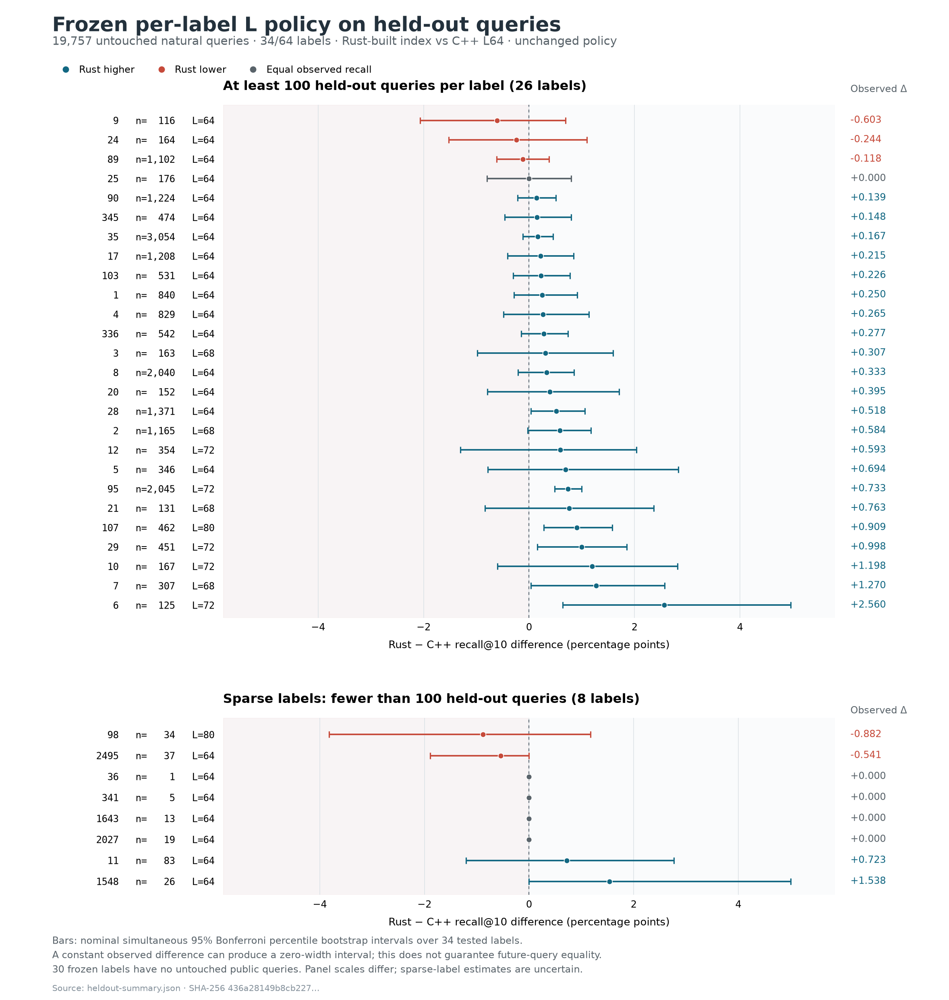

# Held-out validation of the frozen per-label L policy

The throughput gain generalizes to this larger untouched query pool. The stronger claim that every label matches C++ recall does not: five of 34 tested labels have lower observed strict-ID recall. The policy was not changed after seeing these results.

## Aggregate results

YFCC10M, 192-dimensional uint8 L2, top 10, eight workers pinned to physical cores 0–7, beam 4, zero shared graph-node cache, native SSD I/O. Each process performs a full same-process warmup before measurement. Six pairs alternate C++/Rust then Rust/C++, with no concurrent benchmark processes. Values below are medians of six complete repetitions.

| Configuration | Strict-ID recall@10 | QPS | p99 service latency |
|---|---:|---:|---:|
| C++ filtered index, L64 | 94.354% | 3,268.41 | 3.2130 ms |
| Rust native filtered index, frozen per-label L | 94.735% | 3,741.56 | 2.7706 ms |

Rust delivers **14.48% more QPS** with **13.77% lower p99**. It wins all six timing pairs: paired QPS advantages range from 14.28% to 14.73%. Rust QPS ranges 3,738.30–3,744.86; C++ ranges 3,261.01–3,273.85.

The query-weighted recall advantage is **+0.381 percentage points**, with a nominal 95% paired-query bootstrap interval of [+0.301, +0.462] pp. Rust gains strict hits on 1,788 queries, loses hits on 1,170, and ties on 16,799. There are zero filter violations, duplicate results or short outputs in every measured run. No exact fallback or delta scan was used.

Macro label recall is 95.610% for Rust versus 95.215% for C++ (+0.395 pp). Reweighting the same 34 labels to their original tuning weights gives +0.397 pp. These are descriptive recall checks; reweighting does not infer throughput for a different traffic mix.

## What the per-label policy improves

The separate Rust fixed-L64 quality control reaches 94.544%. The frozen policy adds 377 strict ground-truth hits, or **+0.191 pp** (95% paired-query bootstrap [+0.170, +0.213] pp). It improves 341 queries and lowers recall on zero queries relative to fixed L64 in this held-out pool. All 11 testable labels whose L was raised benefit. The number of labels below C++ falls from 10 with Rust fixed L64 to five with the policy. The diagnostic control has one repetition and is excluded from throughput and latency claims.

## Remaining label shortfalls

24 tested labels improve, five tie and five fall below C++ point recall. No label has a wholly negative marginal or simultaneous approximate 95% bootstrap interval. This does not establish noninferiority: intervals still admit meaningful losses, and no noninferiority margin was prespecified. The observed zero-regression requirement fails on these five labels.

| Label | Unique queries | Rust L | C++ recall | Rust recall | Difference, pp | Simultaneous 95% interval, pp |
|---:|---:|---:|---:|---:|---:|---:|
| 9 | 116 | 64 | 93.707% | 93.103% | -0.603 | [-2.069, +0.690] |
| 24 | 164 | 64 | 94.146% | 93.902% | -0.244 | [-1.524, +1.098] |
| 89 | 1,102 | 64 | 93.158% | 93.040% | -0.118 | [-0.617, +0.381] |
| 98 | 34 | 80 | 97.353% | 96.471% | -0.882 | [-3.824, +1.176] |
| 2495 | 37 | 64 | 98.108% | 97.568% | -0.541 | [-1.892, +0.000] |

The independent integer-distance check credits distinct alternative IDs tied at the exact tenth-neighbor distance. All five shortfall labels remain below C++ under that measure; ties do not explain them away. Overall cutoff-qualified recall is 94.850% for Rust versus 94.471% for C++, an advantage of +0.379 pp.

Four shortfall labels (9, 24, 89 and 2495) retained L64 because they passed the original tuning floor. Label 98 was raised to L80 and improves over Rust L64 by +0.588 pp here, but still trails C++ by 0.882 pp. Thus the policy generalizes as a useful quality improvement, while selection against only 10–43 tuning queries per label was insufficient to certify every-label parity on fresh queries. The native Rust graph differs from the C++ graph; this experiment evaluates the complete frozen configurations and does not isolate a language effect or prove a new traversal defect.

## Coverage and distribution limits

Preparation included **every remaining eligible natural one-tag public query** for the frozen 64 labels: **19,757 unique queries covering 34 labels**, 9.88 times the tuning query count. Original query IDs and embeddings have zero overlap with tuning, including across labels, and there are no duplicate held-out embeddings. Prepared vectors, labels and exact ground-truth rows match their original public rows. All 197,570 ground-truth label memberships and exact integer squared-L2 distances were independently checked.

The original tuning workload exhausted the available public one-tag queries for 30 labels. They are untested, rather than passing. Only 11 of the 15 raised-L labels are testable; missing raised labels are 22 (L96), 44 (L96), 5518 (L80) and 7546 (L68). Consequently neither L96 case is tested.

Untested labels: 14, 15, 22, 44, 132, 522, 706, 816, 832, 1016, 1227, 1444, 1835, 2314, 2556, 3030, 3428, 3677, 3901, 3908, 3918, 4736, 5518, 6182, 7546, 8663, 8770, 11614, 13604, 17875.

The original workload balanced labels; this holdout follows the remaining natural query mix. Labels 35, 95 and 8 contribute 36.13% of held-out queries versus 6.35% of tuning queries. Raised-L queries remain about 27.35% of the mix, but query-weighted L falls from 66.674 to **66.0315**. Maximum observed L is 80. This evaluation cannot certify a different production mix or the missing rare labels.

26 labels have at least 100 queries; eight have fewer than 100, and seven have fewer than 50. Recall intervals resample paired query hit-count differences using 100,000 draws; neighbors and timing repetitions are not independent quality samples. Simultaneous intervals use Bonferroni-adjusted percentile bootstrap across the 34 tested labels and have nominal approximate coverage. Empirical zero-width intervals are explicitly flagged and do not guarantee future equality.

## Per-label recall and latency

The table reports the median of six per-label p99 values. All 34 observed Rust medians are lower than C++, but small label samples give weak tail estimates: for fewer than 100 queries, p99 is the maximum observed service call in each repetition. Even labels near 100–200 queries have only one or two tail order statistics. Per-label p99 repeat ranges, median means and recall intervals are in [per-label.csv](per-label.csv); the full summary retains ranges for all timing metrics. Label 107 has a 0.26% higher mean service time (2.4607 versus 2.4543 ms), with overlapping repeat ranges, despite lower median p99.

QPS is measured for the concurrent mixed workload. Per-label service times do not identify isolated per-label QPS; no inverse-latency throughput estimate is presented. These are warmed closed-loop service-call timings, not end-to-end latency under a production arrival process.

| Label | Queries | Rust L | C++ recall | Rust recall | Δ pp | C++ p99 ms | Rust p99 ms |
|---:|---:|---:|---:|---:|---:|---:|---:|
| 1 | 840 | 64 | 95.464% | 95.714% | +0.250 | 2.970 | 2.476 |
| 2 | 1,165 | 68 | 94.240% | 94.824% | +0.584 | 2.995 | 2.761 |
| 3 | 163 | 68 | 92.209% | 92.515% | +0.307 | 3.143 | 2.972 |
| 4 | 829 | 64 | 92.581% | 92.847% | +0.265 | 3.269 | 2.676 |
| 5 | 346 | 64 | 92.052% | 92.746% | +0.694 | 3.661 | 2.606 |
| 6 | 125 | 72 | 92.080% | 94.640% | +2.560 | 3.204 | 2.799 |
| 7 | 307 | 68 | 92.573% | 93.844% | +1.270 | 3.309 | 2.881 |
| 8 | 2,040 | 64 | 90.324% | 90.657% | +0.333 | 3.428 | 3.036 |
| 9 | 116 | 64 | 93.707% | 93.103% | -0.603 | 2.965 | 2.774 |
| 10 | 167 | 72 | 95.269% | 96.467% | +1.198 | 3.023 | 2.792 |
| 11* | 83 | 64 | 93.253% | 93.976% | +0.723 | 3.240 | 2.644 |
| 12 | 354 | 72 | 93.588% | 94.181% | +0.593 | 3.101 | 2.862 |
| 17 | 1,208 | 64 | 93.212% | 93.427% | +0.215 | 3.417 | 2.772 |
| 20 | 152 | 64 | 94.737% | 95.132% | +0.395 | 6.303 | 2.559 |
| 21 | 131 | 68 | 93.359% | 94.122% | +0.763 | 6.229 | 2.821 |
| 24 | 164 | 64 | 94.146% | 93.902% | -0.244 | 6.475 | 2.657 |
| 25 | 176 | 64 | 97.500% | 97.500% | +0.000 | 2.753 | 2.615 |
| 28 | 1,371 | 64 | 94.158% | 94.675% | +0.518 | 3.164 | 2.637 |
| 29 | 451 | 72 | 91.929% | 92.927% | +0.998 | 3.242 | 3.124 |
| 35 | 3,054 | 64 | 94.637% | 94.804% | +0.167 | 3.055 | 2.635 |
| 36* | 1 | 64 | 100.000% | 100.000% | +0.000 | 2.343 | 2.036 |
| 89 | 1,102 | 64 | 93.158% | 93.040% | -0.118 | 3.277 | 2.815 |
| 90 | 1,224 | 64 | 96.936% | 97.075% | +0.139 | 2.953 | 2.547 |
| 95 | 2,045 | 72 | 97.154% | 97.888% | +0.733 | 2.967 | 2.745 |
| 98* | 34 | 80 | 97.353% | 96.471% | -0.882 | 6.366 | 2.917 |
| 103 | 531 | 64 | 96.271% | 96.497% | +0.226 | 3.121 | 2.596 |
| 107 | 462 | 80 | 97.208% | 98.117% | +0.909 | 3.850 | 3.120 |
| 336 | 542 | 64 | 97.343% | 97.620% | +0.277 | 3.199 | 2.654 |
| 341* | 5 | 64 | 100.000% | 100.000% | +0.000 | 2.529 | 2.121 |
| 345 | 474 | 64 | 95.464% | 95.612% | +0.148 | 3.240 | 2.745 |
| 1548* | 26 | 64 | 97.308% | 98.846% | +1.538 | 2.627 | 2.391 |
| 1643* | 13 | 64 | 100.000% | 100.000% | +0.000 | 2.785 | 2.156 |
| 2027* | 19 | 64 | 100.000% | 100.000% | +0.000 | 2.524 | 2.480 |
| 2495* | 37 | 64 | 98.108% | 97.568% | -0.541 | 2.838 | 2.501 |

\* Fewer than 100 unique queries; interpret p99 as a small-sample maximum, not an established tail SLO.

## Timing repetitions

| Pair | Order | C++ QPS | Rust QPS | QPS ratio | C++ p99 ms | Rust p99 ms |
|---:|---|---:|---:|---:|---:|---:|
| 1 | C++ → Rust | 3,261.01 | 3,741.24 | 1.1473× | 3.2673 | 2.7733 |
| 2 | Rust → C++ | 3,265.75 | 3,738.30 | 1.1447× | 3.1970 | 2.7706 |
| 3 | C++ → Rust | 3,265.37 | 3,744.86 | 1.1468× | 3.2228 | 2.7550 |
| 4 | Rust → C++ | 3,273.85 | 3,741.24 | 1.1428× | 3.2162 | 2.7803 |
| 5 | C++ → Rust | 3,271.74 | 3,741.88 | 1.1437× | 3.2098 | 2.7644 |
| 6 | Rust → C++ | 3,271.06 | 3,742.96 | 1.1443× | 3.1919 | 2.7706 |

## Provenance and validation

The original plan bytes remain SHA256 `df42e65440af0a891185913e91f5f22cb6808c9251b2c1d8f6ca968d5bda2e59`. The analyzer independently recomputes the original policy selection from the original grid and C++ tuning evidence. No held-out result changed a breadth, entry point, graph or policy. The only archived Rust source change from v4 is the example driver for query tracing and held-out coverage logging; library search/build/update sources are byte-identical. C++ search binary, graph, PQ and filter sidecar hashes match the original reference. Native CURRENT/CATALOG/WAL identities match the tuned frozen generation. Binaries, source archive and indexes are unchanged before and after timing.

Linux host: Ryzen 7950X, 61 GiB RAM, WD SN850X 2 TB SSD, ext4; eight pinned physical cores. Rust toolchain 1.97.1; Rust base commit `79c5fcf77b6b26c403c3803aa04839e633d15642`; unchanged C++ reference from base `78256bbab4685e1774e78d331e081a153be26823`. Indexes have 10M base vectors; native generation 1, sequence 0 and empty delta. The results describe this benchmark host and metadata-filter proxy workload, rather than Microsoft Ads internal traffic or production ads embeddings.

Retained evidence:

- [Validated full summary](results/heldout-summary.json) and [exact analysis command](results/analysis-command.json).
- [Raw paired run manifest](results/run/paired-run-manifest.json), [identity proof](results/run/identity.json), and all original per-query traces and C++ result matrices under `results/run/`.
- [Host input and source audit](results/run/host-input-source-audit.json): 41 input assets, including postings and the full base, plus 23 build-source files checked against the frozen archive.
- [Frozen benchmark-tool sources](results/benchmark-tools.tar.gz).
- [Complete v5 source bundle](results/lifecycle-v5-heldout-complete-sources.tar.gz), [native test log](results/native-tests.log), [build log](results/native-build.log), and [focused validation](results/validation.json).
- [Held-out preparation manifest](../data/prepared-10m-heldout/manifest.json), [split/exclusion evidence](../data/prepared-10m-heldout/exclusion-evidence.json), and [reproduction procedure](REPRODUCE.md).

The current focused checks pass: eight native Linux Rust example tests, 32 targeted Python validation tests, affected-example clippy with warnings denied, formatting and whitespace checks. Passing provenance and result validation means the measurements are consistent; it does not make the five per-label shortfalls pass an acceptance gate.

## Decision

The frozen policy preserves the throughput gain and improves both aggregate recall and Rust fixed-L64 recall on untouched queries. It does not establish zero per-label regressions. Keep it frozen as the validated candidate; before accepting every-label production parity, define a recall-loss tolerance in advance and evaluate fresh ads queries for every required label, especially the 30 uncovered labels. Retuning the five exposed labels on this holdout would consume it as calibration data and require another independent validation set.
